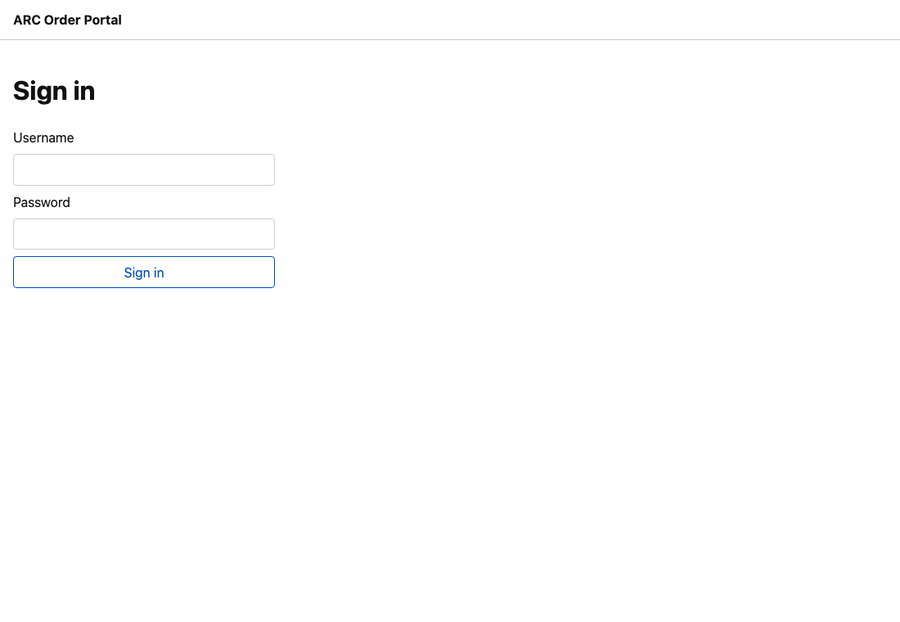
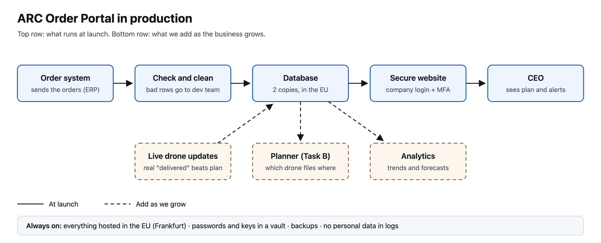

# ARC Order Portal

A CEO portal for the ARC drone delivery takehome: when each order ships, when it arrives, what needs attention today, and why some orders fail.



## What it does

- **Orders:** stage pipeline (in production → ready → in transit → delivered), search by order ID, 50 per page, a timeline per order with its stage owner.
- **Needs your attention today:** orders that miss the 5-day promise, ship today or arrive today, each with a one-click reminder (a pre-filled email from the CEO's own mail app).
- **Insights:** KPIs, orders per day by status, why orders fail (holiday at destination, data errors in plain words), cumulative deliveries, orders by city.
- **Data cleanup:** 2,000 CSV lines → 1,946 orders, 49 rows rejected with reasons, 3 duplicates removed. Data errors go to the dev team, not the CEO.

Rules: ship date = ready date; delivery = 3 working days later, skipping weekends and public holidays at the factory (NRW) **and** the destination state.

## Run it

```bash
uv sync
cp .env.example .env && chmod 600 .env     # then fill in the hash and secret as the comments explain
uv run python -m portal.importer data/orders-2000.csv data/portal.db
uv run uvicorn portal.app:create_app --factory --env-file .env --no-access-log --no-server-header
# open http://localhost:8000 in Chrome or Firefox (user: ceo)
uv run pytest      # 68 tests
```

## Layout

| Path | What |
|---|---|
| `portal/importer.py` | CSV → cleanup rules → SQLite (atomic swap, owner-only file) |
| `portal/dates.py` | working days, holidays per state |
| `portal/app.py` | FastAPI: login, orders, order detail, insights, data import report, security headers |
| `portal/insights.py` | chart data; charts are server-rendered SVG, no JavaScript |
| `contacts.toml` | stage owners (placeholder role mailboxes) |
| `docs/` | [research](docs/research.md) · [data analysis](docs/data-analysis.md) · [plan](docs/plan.md) · [Task B algorithm](docs/task-b-algorithm.md) · [Task C design + diagrams](docs/design.md) |
| `MEMORY.md` | project state for anyone (or any agent) picking this up |
| `PRESENTATION.md` | the 2-minute summary of the work |

## Tasks

- **A, portal:** this app.
- **B, maximise orders within 5 days:** pseudocode in [logic.md](logic.md), full write-up in [docs/task-b-algorithm.md](docs/task-b-algorithm.md). Daily re-plan, earliest deadline first, 7 zone loops (35–42 % less flight time), Moore–Hodgson drop step, CP-SAT as the exact variant.
- **C, hosting:** architecture at scale in [docs/architecture.md](docs/architecture.md), details in [docs/design.md](docs/design.md). AWS Frankfurt, SSO + MFA, Fargate in 2 AZs, Multi-AZ Postgres, Secrets Manager. Includes data-flow diagrams and failure modes.



## Privacy and security

- All order data stays on the server; pages are `no-store`; no scripts, CDNs, fonts or analytics (strict CSP).
- Data minimisation: no prices or currency stored or shown.
- Secrets only in `.env` (gitignored, 0600); argon2 password hash; app refuses to start without its secrets or its data.
- Session cookie `HttpOnly`, `Secure`, `SameSite=Strict`, 8 h. Login rate-limited. No order IDs in logs.
- GDPR, BDSG, TDDDG, EU drone rules and consumer law: [docs/research.md](docs/research.md) (not legal advice).

## Known limits

- Statuses are **planned**, not actual: there are no delivery events in the data. [design.md §5](docs/design.md) describes the events feed.
- Holiday table covers 2 Nov 2026 – 25 Mar 2027; dates outside are flagged.
- Login rate limit is per process; production uses SSO + WAF.
- Legal and regulatory notes are from research, to be confirmed by counsel.
