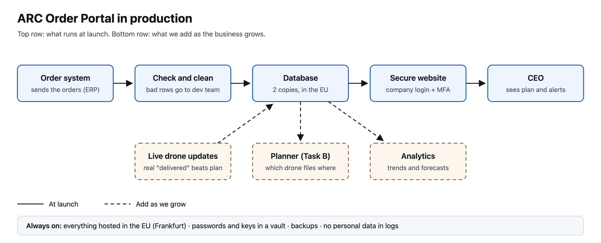
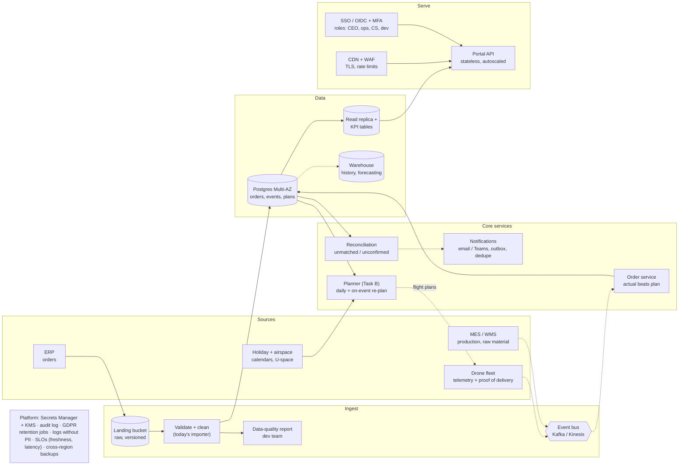

# Production architecture at scale (Task C showcase)

Simple version above ([svg](architecture.svg)). For deeper questions: [detailed version](architecture-detailed.png) ([svg](architecture-detailed.svg)), which matches the Mermaid diagram below.

Solid = build first. Dashed = add when scale or scope demands it. Everything runs in one EU region (Frankfurt), with backups in a second EU region.

## Talking points

1. **Plan vs actual.** Today every status is planned. The first addition is the fleet's event feed: real events overwrite planned dates, and a reconciliation job flags unmatched or unconfirmed deliveries.
2. **Idempotency.** Events carry IDs and consumers deduplicate. Imports swap atomically; the planner gives the same plan for the same state. Retries are always safe.
3. **Failure isolation.** A bad export is quarantined, not loaded. A slow planner never blocks the portal (read replica). Notifications go through an outbox, so a mail outage loses nothing.
4. **Scale path.** The read side scales out (stateless API, replica, KPI tables). The write side stays a single Postgres primary for a long time. Shard only by region, if the fleet goes multi-site.
5. **Full supply chain.** Production (MES) and raw material (WMS) join the same bus. Their stages show up in the pipeline only when real data exists.
6. **Compliance.** EU-only data path, DPA with the cloud provider, role-based access, audit log, retention jobs. Drone ops add a DPIA (data protection impact assessment) if cameras are fitted.
7. **Deliberately not yet:** microservices per entity, a multi-region active-active setup, ML. Each one is added only when a measured need appears.
