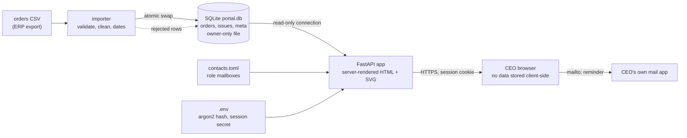
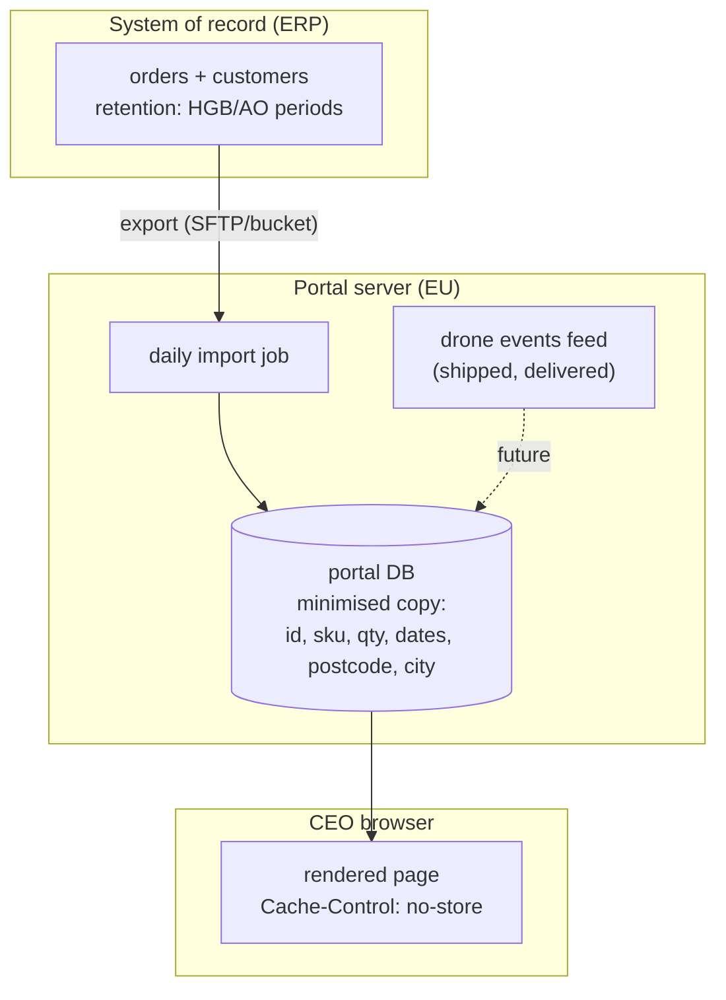
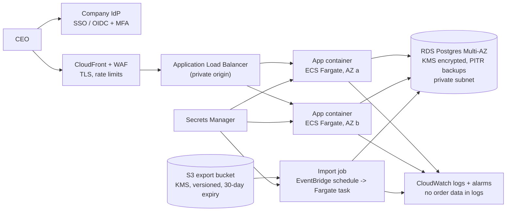

# System design and hosting (Task C)

## 1. Prototype as built

- One process, one SQLite file. Read-mostly, with one source of data: there is no need for microservices, a cache or a distributed database.
- The importer is idempotent: the same CSV always gives the same database, and a failed import keeps the old one.
- The portal never writes order data. Reminders are mailto links, so the server holds no mail credentials.

## 2. Data flow and where data lives

- **Server only:** all order data. **Client:** only the page currently open (no localStorage, no caching, no scripts).
- **Minimised:** prices and currency are never stored. The portal is a copy, not the system of record; erasure happens in the ERP and flows through on the next import.

## 3. Production hosting (AWS, Frankfurt eu-central-1)

| Concern | Choice |
|---|---|
| Residency (GDPR Ch. V) | Single EU region, AWS DPA signed (Art. 28), no US-only services in the data path |
| Identity | SSO via the company IdP with MFA replaces the local password; app trusts the OIDC token only |
| Access control | CEO role read-only; dev team role sees the import report; DB users: app = SELECT only, import job = write, no human DB access except break-glass |
| Secrets | Secrets Manager, rotated; nothing in images, env files or repo; gitleaks in CI |
| Encryption | TLS everywhere, KMS at rest (RDS, S3, logs) |
| Availability | 2 app tasks in 2 AZs, Multi-AZ database; RPO ≤ 5 min (PITR), RTO ≤ 1 h. Good enough for an internal read-only tool |
| Cost | Small: 2 tiny Fargate tasks, a db.t4g.small Multi-AZ, a daily job |

## 4. Failure modes

| Failure | What happens | Mitigation |
|---|---|---|
| Bad rows in the export | Rejected or flagged with a reason; never silently dropped | Dev team report + notify button; fix at the source |
| Wrong file / wrong header | Import aborts, old data stays | Header check before any write; alarm on failed job |
| Import job doesn't run | Data goes stale | "Figures may be out of date" banner after 24 h; CloudWatch alarm |
| Database down | Pages fail | Multi-AZ failover; health check takes the task out of the LB |
| App task crashes | Other AZ serves | ECS restarts it; stateless app (sessions are signed cookies) |
| Brute-force login | Blocked after 5 tries / 15 min | WAF rate limit in production; SSO + MFA |
| Secret leak | Session forgery | Rotate in Secrets Manager → all sessions invalid; gitleaks in CI |
| Holiday table out of range | Delivery dates may be off | Importer flags it; replace the table with a maintained holiday source |
| Plan ≠ reality | Portal shows planned, not actual | Events feed (next section) |

## 5. Next: actual events instead of plan only

Today every status is derived from planned dates (ready + 3 working days). Production needs a feed of real events:

1. **Events table** `(order_id, event: shipped | delivered, at, source)` from the drone fleet system and proof of delivery.
2. **Actual beats plan:** status = latest event; planned dates only fill the gaps.
3. **Daily reconciliation:** a delivery event for an unknown or on-hold order → "unmatched delivery" to the dev team, counted as delivered for the CEO;
   planned delivery passed with no event after 1 working day → "delivery not confirmed" in the CEO's attention panel.
4. **Insights:** split "delivered, confirmed" from "delivered, planned"; on-time KPI from real timestamps.
5. **Upstream stages** (raw material, production steps) join the same way, once those systems expose data. Nothing is invented until then.

## 6. Deliberately not built

Microservices, a message bus, a cache, a distributed database, server-side email sending, JavaScript charts: none is justified by ~2,000 orders, one source and one reader.
